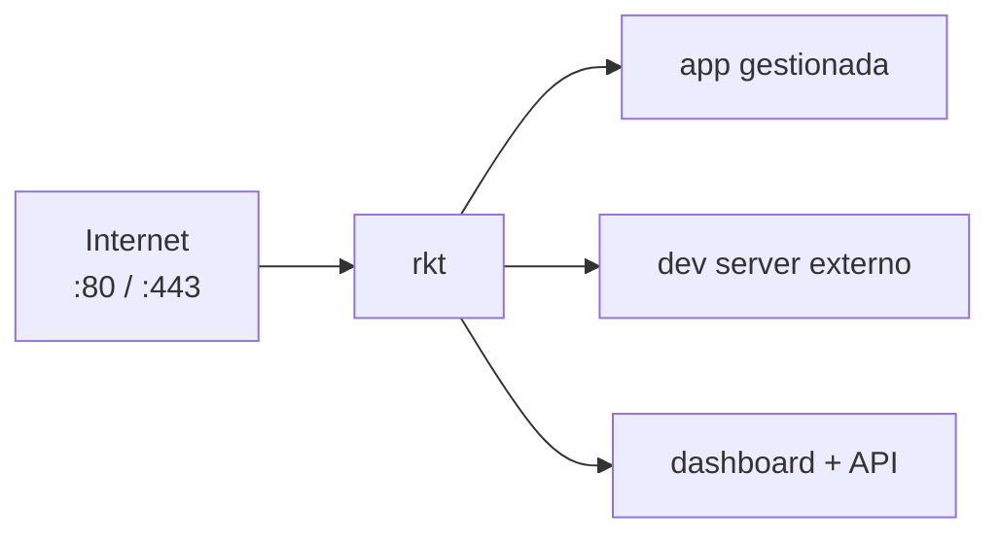
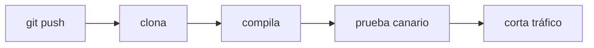
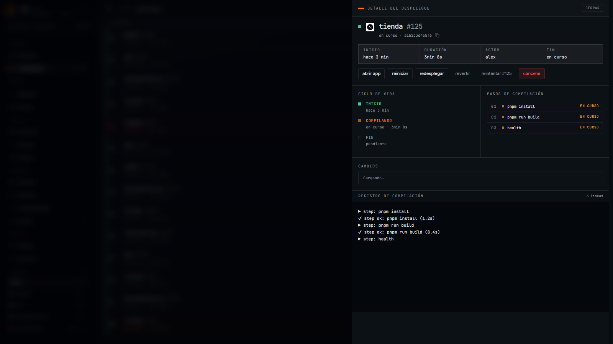
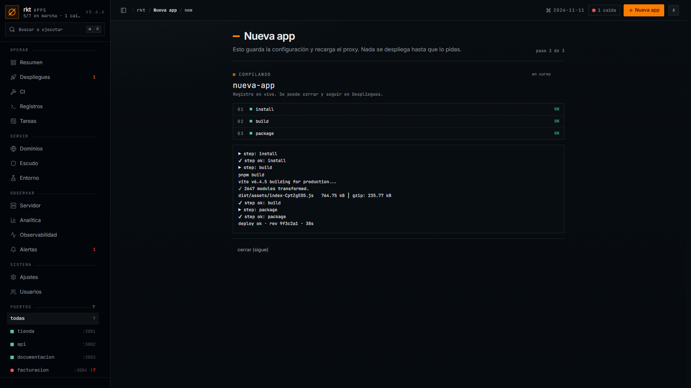

<p align="center">
  
</p>

# rkt

[](https://github.com/carlos-burelo/rkt/releases/latest)
[](https://github.com/carlos-burelo/rkt)
[](LICENSE)

Un solo binario para servir apps web en Windows Server: proxy inverso con
TLS automático, supervisor de procesos, deploys desde Git, tareas
programadas, dashboard y acceso para agentes (MCP). Todo vive en SQLite y
bajo un solo directorio; nada que editar a mano.



## Qué hace

- **Dominios hacia tus apps**: `app.tudominio.com`, `*.tudominio.com` o `IP/app`. Sin ruta: 404.
- **HTTPS automático**: Let's Encrypt en producción; CA local en desarrollo.
- **Tareas programadas**: un comando o una petición HTTP por app, con historial y sin solapes.
- **Procesos supervisados**: reinicio con backoff, límite de memoria y parada limpia del árbol completo.
- **Dev servers externos**: expone `pnpm dev`, Vite o similar bajo el mismo proxy sin gestionarlos.
- **Deploys desde Git**: compila aparte, prueba un canario y corta el tráfico sin caídas; si algo falla, vuelve solo.



- **GitHub App**: conecta tu cuenta y despliega solo al hacer push (webhook en producción, polling en local).
- **Detecta el stack**: Node, Go, Python, estáticos y más; Node siempre con pnpm.
- **Dashboard con roles**: ver, operar y administrar, desde el navegador.
- **CLI y MCP**: todo lo del panel, también por terminal y por API para agentes.

## Dashboard

<p align="center">
  
  
</p>
<p align="center">
  
  
</p>
<p align="center">
  
  
</p>

## Dos tipos de app

**Gestionada**: rkt arranca el proceso, lo supervisa y lo despliega.

**Externa**: rkt no ejecuta nada; solo le da dominio y puerto a un dev server que corres tú (`pnpm dev`, Vite, Next dev…). La ficha muestra el comando sugerido y si responde o no.

## Plataformas

Windows Server es la plataforma soportada en producción. El backend también
compila y corre en Linux (sin tope de RAM y sin CA automática).

## Inicio rápido (desarrollo)

Requisitos: Windows, Go 1.26+, Node 22+ y pnpm.

```powershell
pnpm --dir web install
pnpm --dir web build
go build -o bin/rkt.exe ./cmd/rkt-proxy
bin\rkt.exe -config rkt.local.db dev
```

- Dashboard: `http://127.0.0.1:8090`
- HTTP/HTTPS: `127.0.0.1:80` y `127.0.0.1:443`
- Dominios locales: `*.localhost` (resuelven solos)
- Sin `public_ip`, las apps nuevas usan `<app>.localhost`; en servidor público define `public_ip` y `base_domain`
- CA local: `logs/devca/ca.crt`, instalada en el almacén del usuario

## Instalación en producción

Requisitos: registro DNS `A`, puertos `80/443` abiertos y PowerShell como
administrador.

Primera vez (un comando):

```powershell
irm https://raw.githubusercontent.com/carlos-burelo/rkt/main/scripts/install.ps1 | iex
```

Para borrar todo rastro antes de instalar (servicio, datos, firewall,
variables; lo de usuario va a `apps.old`/`certs.old`), script dedicado:

```powershell
& ([scriptblock]::Create((irm https://raw.githubusercontent.com/carlos-burelo/rkt/main/scripts/nuke.ps1)))
```

El instalador descarga el release, verifica checksum, registra el servicio
Windows, abre firewall y deja `rkt` en el `PATH`. También detecta la IP
pública, expone el dashboard en `http://IP:8090` y crea el primer admin con
password aleatoria (la imprime una vez). Sin YAML: todo se administra desde
el dashboard o el CLI.

Todo vive bajo un solo home (`-InstallDir`, por defecto
`C:\Program Files\rkt-proxy`):

```text
rkt.exe, VERSION.txt      binario y versión
data\rkt.db               SQLite (config + flota)
data\backups\             copias diarias
secrets\                  github.token, github-app.pem
logs\                     rkt.log, access.log, control.token, apps\, deploys\
apps\<name>\              repos, slots .a/.b y datos de cada app
certs\                    cache ACME
```

Opciones: `-NoPublicDashboard` deja el dashboard solo en loopback;
`-AdminUser nombre` cambia el usuario inicial.
Al actualizar sin destruir, la DB y los backups se mudan solos al primer
arranque; las apps viejas conservan su carpeta y siguen sirviendo.

## CLI

```powershell
rkt status
rkt apps list
rkt apps add --name app --repo https://github.com/o/app.git --domain app.example.com --auto
rkt apps add --external --name preview --dir C:\dev\preview --domain preview.localhost
rkt routes list
rkt deploy app
rkt rollback app
rkt logs -f -app app
rkt doctor
rkt config export respaldo.json
```

Referencia completa: [docs/CLI.md](docs/CLI.md).

## GitHub App

1. Dashboard → **Ajustes → GitHub App → crear GitHub App**.
2. Crear la App en GitHub y elegir **All repositories**.
3. Instalar y volver al dashboard: el selector de “nueva app” ya lista tus repos.

## Operación

- **Health**: `GET http://127.0.0.1:8090/healthz` (solo loopback).
- **Logs**: `rkt logs -f` o dashboard; los de build llegan en vivo.
- **Deploy**: historial en SQLite con su build log; rollback automático si falla la salud.
- **Seguridad**: sesiones httpOnly, CSRF por `Origin` y secretos fuera del código.

## Desarrollo y pruebas

```powershell
gofmt -l .
go run ./tests/run.go vet ./...
go run ./tests/run.go test ./... -count=1
pnpm --dir web exec tsc --noEmit
pnpm --dir web test
pnpm --dir web build
```

Suite de navegador y organización de pruebas: [tests/README.md](tests/README.md).

Las capturas se generan con datos ficticios desde `scripts/shots`:
`pnpm --dir scripts/shots mock` con `web` en `:5173`.

## Estructura

```text
cmd/rkt-proxy          entrada CLI
internal/api           API REST / SSE
internal/app           orquestación, deploy y runtime
internal/supervisor    procesos, reinicios, Job Objects
internal/deploy        clone, build, swap, rollback
internal/cronjobs      scheduler y ejecución de tareas
internal/domains       dominios por defecto según modo de red
internal/github        GitHub App, tokens, repos
internal/proxy         routing por Host
internal/config        modelo y validación
internal/store         SQLite
internal/dashboard     SPA embebida
web/                   React + Vite + Tailwind
docs/                  CLI, especificación y capturas
scripts/               install.ps1 (instala) y nuke.ps1 (borra todo rastro)
```

## Documentación

- [CLI](docs/CLI.md)
- [Arquitectura](docs/ARCHITECTURE.md)
- [Especificación del dashboard](docs/SPEC.md)
- [AADR de expansión por módulos](docs/AADR.md)
- [Diseño del dashboard](DESIGN.md)
- [Producto](PRODUCT.md)
- [Capturas](docs/shots/README.md)

## Licencia

MIT. Ver [LICENSE](LICENSE).
