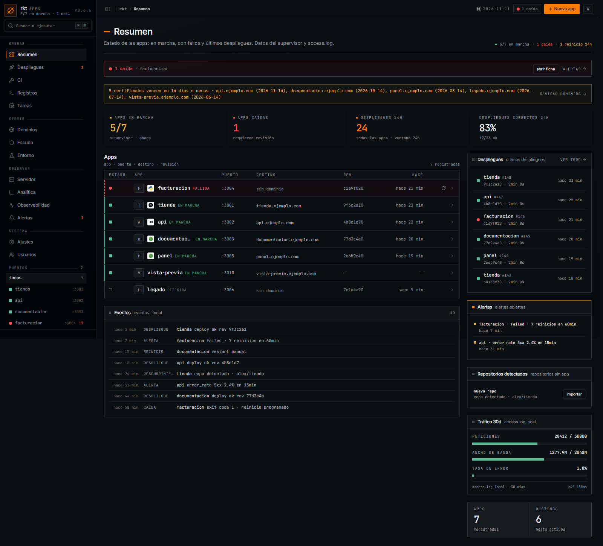
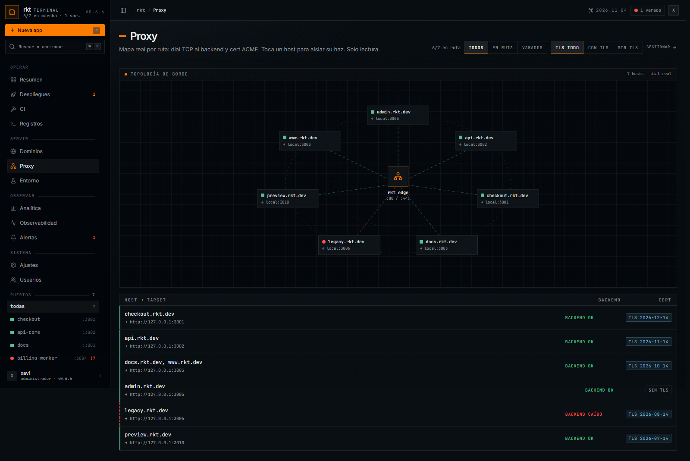
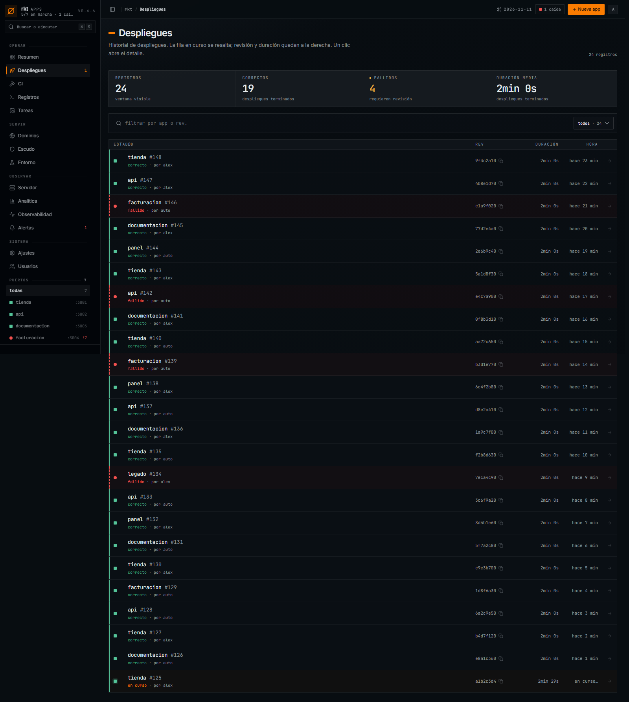
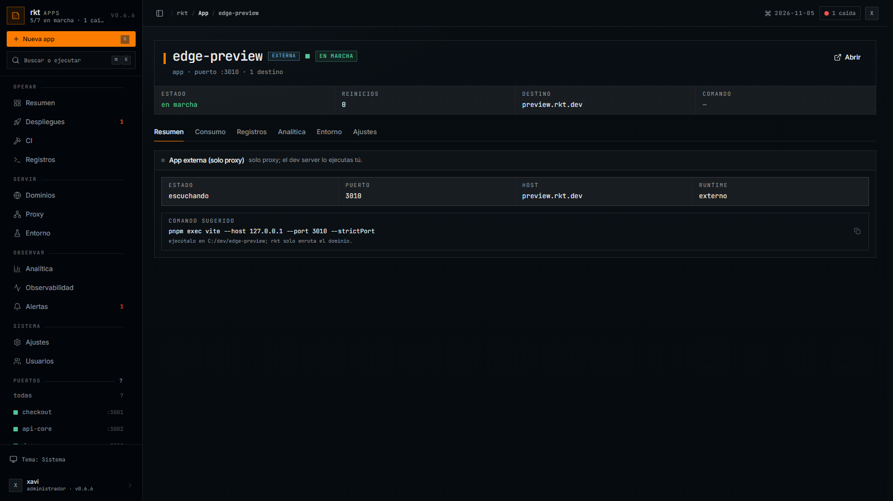

# rkt

[](https://github.com/carlos-burelo/rkt/releases/latest)
[](https://go.dev)
[](https://github.com/carlos-burelo/rkt)
[](LICENSE)

PaaS para **Windows Server** en un solo binario Go. Proxy inverso con TLS
automático, supervisor de procesos, deploys desde Git, dashboard y servidor MCP.
La configuración vive en **SQLite**; no hay YAML ni archivos de estado paralelos.

```text
Internet ──:80/:443──▶ rkt ──HTTP──▶ 127.0.0.1:3001  app gestionada
                              ├────▶ 127.0.0.1:3010  dev server externo
                              └────▶ 127.0.0.1:8090  dashboard + API (loopback)
```



## Capacidades

- **Routing por Host**: coincidencia exacta y comodín `*.dominio`, con
  prioridad exacta. Sin ruta → `404`; backend caído → `502`.
- **TLS automático**: Let's Encrypt (`tls-alpn-01` + `http-01`) en producción;
  CA local y `.localhost` en desarrollo. Renovación y cache separada
  staging/producción.
- **Apps gestionadas**: supervisor con reinicio, backoff, límite de RAM,
  Job Objects (mata el árbol completo en Windows), logs por app y health checks.
- **Apps externas**: registro de host/puerto para un dev server que corre el
  humano. Solo usan proxy, TLS, access log y dashboard; no hay build, deploy ni
  supervisor.
- **Deploy desde Git**: clone, build, swap atómico, restart, verificación y
  rollback automático si la versión nueva no queda sana.
- **GitHub App**: instalación desde el dashboard, repos personales y de
  organizaciones, auto-deploy por webhook (producción) o polling (local).
- **Buildpacks propios**: Next, Vite, Astro, SvelteKit, Nuxt, Remix, Node, Go,
  Python y sitios estáticos. Node siempre con **pnpm**.
- **Observabilidad**: logs de app y build en vivo por SSE, access log,
  analítica, métricas, alertas y backends reales.
- **Dashboard SPA** embebida, PWA, autenticación por cookie httpOnly y roles
  `viewer < operator < admin`.
- **CLI y MCP** sobre la misma API y el mismo modelo de datos.

## Dashboard

<p align="center">
  
  
</p>
<p align="center">
  
  
</p>

## Modelo de aplicaciones

### Gestionada (`managed`)

rkt arranca el proceso, lo supervisa y aplica el pipeline de deploy.

```text
Git push ─▶ clone ─▶ build ─▶ swap live/prev ─▶ restart ─▶ health ─▶ rollback si falla
```

### Externa (`external`)

rkt **no ejecuta nada**. Registra la carpeta, el host y el puerto para que el
dev server (`pnpm dev`, Vite, Next dev, etc.) sea accesible bajo la misma
arquitectura de proxy.

```text
rkt: host ─▶ 127.0.0.1:3010
humano: pnpm exec vite --host 127.0.0.1 --port 3010 --strictPort
```

La ficha de la app muestra el comando sugerido y su estado real (TCP/HTTP).
No aparecen acciones de deploy, restart ni rollback.

## Plataformas

Windows Server es la plataforma soportada en producción. El backend ya separa
las diferencias de sistema en `internal/platform` y wrappers con build tags:
Linux/Unix compila y funciona con process groups, métricas `/proc`, shell
`sh -c` y `/etc/hosts`. CI ejecuta build+vet+tests en Ubuntu. Limitaciones
conscientes en Linux: sin tope de RAM (Job Objects) y CA de desarrollo manual
(`SSL_CERT_FILE`).

## Inicio rápido (desarrollo)

Requisitos: Windows, Go 1.26+, Node 22+ y pnpm.

```powershell
pnpm --dir web install
pnpm --dir web build
go build -o bin/rkt.exe ./cmd/rkt-proxy
bin\rkt.exe -config rkt.dev.db dev
```

- Dashboard: `http://127.0.0.1:8090`
- HTTP/HTTPS: `127.0.0.1:80` y `127.0.0.1:443`
- Dominios locales: `*.localhost` (resuelven solos) o `rkt hosts add <host>`
- CA local: `logs/devca/ca.crt`, instalada en el almacén del usuario

## Instalación en producción

Requisitos: registro DNS `A`, puertos `80/443` abiertos y PowerShell como
administrador.

```powershell
irm https://raw.githubusercontent.com/carlos-burelo/rkt/main/scripts/install.ps1 | iex
```

El instalador descarga el release, verifica checksum, registra el servicio
Windows, abre firewall y deja `rkt` en el `PATH`. La configuración se administra
desde el dashboard o el CLI; no se edita YAML.

## CLI

```powershell
rkt status
rkt apps list
rkt apps add --name app --repo https://github.com/o/app.git --domain app.example.com --auto
rkt apps add --external --name preview --dir C:\dev\preview --domain preview.localhost
rkt routes list
rkt deploy app
rkt rollback app
rkt logs -f -app app
rkt config export respaldo.json
```

Referencia completa: [docs/CLI.md](docs/CLI.md).

## GitHub App

1. Dashboard → **Ajustes → GitHub App → crear GitHub App**.
2. Crear la App en GitHub y elegir **All repositories** (incluidas las
   organizaciones donde el usuario sea admin).
3. Instalar y volver al dashboard. El selector de repositorios de “nueva app”
   lista los repos accesibles a todas las instalaciones.

En producción los pushes llegan por webhook. En local, GitHub no puede entregar
webhooks a `localhost`: rkt usa polling cada 10 s y compara el `HEAD` local con
el remoto.

## Operación

- **Health**: `GET http://127.0.0.1:8090/healthz` (solo loopback).
- **Logs**: `rkt logs -f` o dashboard; los logs de build se transmiten por SSE.
- **Deploy**: historial en SQLite, build log por deployment y rollback
  automático ante fallo de salud o crashloop reciente.
- **Seguridad**: sesiones httpOnly, CSRF por `Origin`, secretos solo en
  Entorno, healthz nunca expuesto en LAN y apps externas sin pipeline.

## Desarrollo y pruebas

```powershell
gofmt -l .
go vet ./...
go test ./...
pnpm --dir web exec tsc --noEmit
pnpm --dir web build
```

Las capturas del dashboard se generan con datos ficticios (sin datos reales)
desde `scripts/shots`: `pnpm --dir scripts/shots mock` con `web` en `:5173`.
Para capturar un entorno real: `pnpm --dir scripts/shots shots`.

## Estructura

```text
cmd/rkt-proxy          entrada CLI
internal/api           API REST / SSE
internal/app           orquestación, deploy y runtime
internal/supervisor    procesos, reinicios, Job Objects
internal/deploy        clone, build, swap, rollback
internal/github        GitHub App, tokens, repos
internal/proxy         routing por Host
internal/config        modelo y validación
internal/store         SQLite
internal/dashboard     SPA embebida
web/                   React + Vite + Tailwind
docs/                  CLI, especificación y capturas
```

## Documentación

- [CLI](docs/CLI.md)
- [Especificación del dashboard](docs/SPEC.md)
- [AADR de expansión por módulos](docs/AADR.md)
- [Capturas](docs/shots/README.md)

## Licencia

MIT. Ver [LICENSE](LICENSE).
